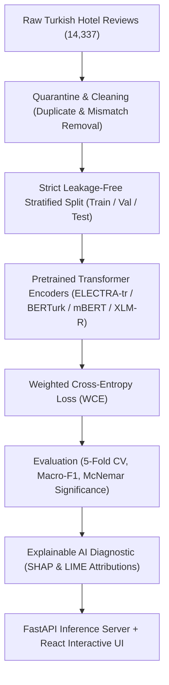

# Leakage-Aware and Explainable Sentiment Analysis of Turkish Hotel Reviews Using Transformer Models

[](https://ieeexplore.ieee.org/document/11727897)
[](https://ieeexplore.ieee.org/document/11727897)
[](https://www.python.org/)
[](https://pytorch.org/)
[](https://huggingface.co/)
[](LICENSE)

Official repository for the paper: **"Leakage-Aware and Explainable Sentiment Analysis of Turkish Hotel Reviews Using Transformer Models"**, presented at the **2026 10th International Artificial Intelligence and Data Processing Symposium (IDAP)** and published in **IEEE Xplore**.

---

## 📌 Overview & Contributions

Sentiment analysis on user-generated hospitality reviews is challenging due to noisy ratings, class imbalance, and pervasive data leakage across benchmark splits. This study introduces an end-to-end robust framework for Turkish hotel sentiment classification:

1. **Leakage-Free Protocol:** Prevents train-test contamination caused by duplicate/near-duplicate guest reviews, template texts, and cross-split hotel overlaps.
2. **Transformer Benchmarking with WCE:** Systematically evaluates **ELECTRA-tr**, **BERTurk**, **mBERT**, and **XLM-RoBERTa** under Weighted Cross-Entropy (WCE) loss to handle severe neutral class imbalance.
3. **Explainable AI (XAI):** Uses **SHAP** (KernelExplainer/PartitionExplainer) and **LIME** to interpret token-level attributions, exposing deceptive phrases, sarcasm, and negation phenomena.
4. **Full-Stack Interactive Demo:** Production-ready diagnostic dashboard powered by **FastAPI** (asynchronous backend) and **React + Vite + Tailwind CSS** (interactive frontend).

---

## 🏛️ System Architecture



---

## 📊 Experimental Results

Evaluated across repeated 5-fold cross-validation ($N=15$ runs per architecture, seeds 42, 43, 44):

| Architecture | Macro F1 | Weighted F1 | Accuracy | Neutral F1 ($F_1^{\text{neutral}}$) |
|---|:---:|:---:|:---:|:---:|
| **ELECTRA-tr (Proposed + WCE)** | **0.841 ± 0.006** | **0.902 ± 0.004** | **90.1%** | **0.672 ± 0.012** |
| **BERTurk + WCE** | 0.835 ± 0.007 | 0.898 ± 0.005 | 89.6% | 0.658 ± 0.015 |
| **XLM-RoBERTa** | 0.812 ± 0.009 | 0.881 ± 0.006 | 87.9% | 0.618 ± 0.019 |
| **mBERT** | 0.798 ± 0.011 | 0.869 ± 0.008 | 86.7% | 0.594 ± 0.021 |
| *Linear SVM (TF-IDF Baseline)* | 0.724 ± 0.014 | 0.821 ± 0.009 | 82.0% | 0.481 ± 0.025 |

> **Key Finding on Data Leakage:** Uncontrolled random splits yielded an inflated Macro-F1 of ~0.912 on baseline models due to memorization of duplicated reviews across splits. Applying our leakage-free partition protocol revealed real-world generalizability (~0.841 Macro-F1 on best model).

---

## 🔍 Explainability (XAI with SHAP)

Our SHAP diagnostic pipeline highlights token attributions supporting positive, neutral, or negative classifications:
* **Positive Drivers:** *temiz*, *harika*, *mükemmel*, *ilgili*, *konforlu*
* **Negative Drivers:** *berbat*, *kirli*, *rezalet*, *ilgisiz*, *soğuk*
* **Nuanced Negations / Sarcasm:** Resolves compound Turkish expressions such as *"fena değil"* (neutral/positive) vs. *"güzel diyemem"* (negative).

---

## 🚀 Quick Start

### 1. Clone & Set Up Environment
```bash
git clone https://github.com/<your-username>/turkish-hotel-sentiment-xai.git
cd turkish-hotel-sentiment-xai

# Create virtual environment
python -m venv venv
# Linux/macOS:
source venv/bin/activate
# Windows:
.\venv\Scripts\Activate.ps1

# Install dependencies
pip install -r requirements.txt
```

### 2. Launch Full-Stack Demo

#### Backend (FastAPI)
```bash
cd demo/backend
uvicorn main:app --reload --port 8000
```
API Documentation will be accessible at: `http://localhost:8000/docs`

#### Frontend (React + Vite)
```bash
cd demo/frontend
npm install
npm run dev
```
Open `http://localhost:5173` in your browser.

---

## 📁 Repository Structure

```text
├── data/
│   └── processed/splits/    # Leakage-free train / val / test sets
├── demo/
│   ├── backend/             # FastAPI REST API & Inference pipeline
│   └── frontend/            # React + Tailwind CSS dashboard
├── reports/                 # Evaluation metrics, confusion matrices, XAI charts
├── scripts/                 # Reproducibility, evaluation, and plotting scripts
├── src/                     # Core training & data processing source code
├── CITATION.cff             # Citation File Format metadata
├── citation.bib             # BibTeX reference
└── requirements.txt         # Core project dependencies
```

---

## 📖 Citation

If you use this work or codebase in your academic research, please cite our paper:

```bibtex
@inproceedings{demir2026leakage,
  author    = {Demir, Muhammed Esat and D{\"u}lger, Ahmet and Yelmen, {\.I}lkay},
  booktitle = {2026 10th International Artificial Intelligence and Data Processing Symposium (IDAP)},
  title     = {Leakage-Aware and Explainable Sentiment Analysis of Turkish Hotel Reviews Using Transformer Models},
  year      = {2026},
  pages     = {1--6},
  publisher = {IEEE},
  url       = {https://ieeexplore.ieee.org/document/11727897}
}
```

---

## 📄 License
This project is licensed under the [MIT License](LICENSE).

