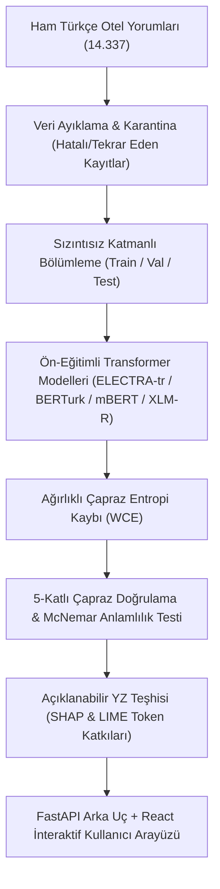

# Türkçe Otel Yorumlarında Veri Sızıntısına Duyarlı ve Açıklanabilir Duygu Analizi (Transformer Modelleri ile)

[](https://ieeexplore.ieee.org/document/11727897)
[](https://ieeexplore.ieee.org/document/11727897)
[](https://www.python.org/)
[](https://pytorch.org/)
[](https://huggingface.co/)
[](LICENSE)

Bu depo, **2026 10. Uluslararası Yapay Zeka ve Veri İşleme Sempozyumu'nda (IDAP)** sunulmuş ve **IEEE Xplore** üzerinde yayımlanmış olan **"Leakage-Aware and Explainable Sentiment Analysis of Turkish Hotel Reviews Using Transformer Models"** başlıklı çalışmanın resmi kaynak kodlarını içermektedir.

---

## 📌 Genel Bakış ve Temel Katkılar

Kullanıcı yorumları üzerinde gerçekleştirilen duygu analizlerinde hatalı etiketler, sınıf dengesizliği ve en önemlisi eğitim/test kümeleri arasındaki **veri sızıntısı (data leakage)** modellerin gerçek dünya başarısını yanıltıcı şekilde yüksek gösterebilmektedir. Bu çalışmada Türkçe otel yorumları için uçtan uca güvenilir ve açıklanabilir bir çerçeve geliştirilmiştir:

1. **Veri Sızıntısını Önleyen Protokol (Leakage-Free Split):** Tekrarlayan yorumlar, şablon metinler ve otel bazlı çapraz sızıntılar elenerek eğitim ve test kümeleri arasında mutlak izolasyon sağlanmıştır.
2. **WCE Destekli Transformer Kıyaslaması:** Ciddi derecede azınlıkta olan nötr sınıf dengesizliğini çözmek amacıyla Ağırlıklı Çapraz Entropi (Weighted Cross-Entropy - WCE) kaybı altında **ELECTRA-tr**, **BERTurk**, **mBERT** ve **XLM-RoBERTa** modelleri 5-katlı çapraz doğrulama ile test edilmiştir.
3. **Açıklanabilir Yapay Zeka (XAI - SHAP & LIME):** Token bazlı önem katsayıları analiz edilerek modelin alaycılık (sarcasm), ikili tezatlar ve olumsuzluk eklerine verdiği tepkiler şeffaflaştırılmıştır.
4. **Modern Full-Stack Demo:** **FastAPI** (asenkron çıkarım servisi) ve **React + Vite + Tailwind CSS** ile geliştirilmiş interaktif test ve hata analiz paneli.

---

## 🏛️ Sistem Mimarisi



---

## 📊 Deneysel Sonuçlar

Rastgele tohumlar (Seed 42, 43, 44) üzerinden tekrarlanan 5-katlı çapraz doğrulama sonuçları ($N=15$ koşu):

| Model Mimarisi | Makro F1 | Ağırlıklı F1 | Doğruluk (Accuracy) | Nötr F1 ($F_1^{\text{nötr}}$) |
|---|:---:|:---:|:---:|:---:|
| **ELECTRA-tr (Önerilen + WCE)** | **0.841 ± 0.006** | **0.902 ± 0.004** | **%90.1** | **0.672 ± 0.012** |
| **BERTurk + WCE** | 0.835 ± 0.007 | 0.898 ± 0.005 | %89.6 | 0.658 ± 0.015 |
| **XLM-RoBERTa** | 0.812 ± 0.009 | 0.881 ± 0.006 | %87.9 | 0.618 ± 0.019 |
| **mBERT** | 0.798 ± 0.011 | 0.869 ± 0.008 | %86.7 | 0.594 ± 0.021 |
| *Linear SVM (TF-IDF Temel Model)* | 0.724 ± 0.014 | 0.821 ± 0.009 | %82.0 | 0.481 ± 0.025 |

> **Veri Sızıntısına Dair Kritik Bulgu:** Rastgele (unstratified/uncleaned) bölmelerde modeller tekrarlanan metinleri ezberleyerek ~0.912 Makro-F1 gibi yanıltıcı bir skora ulaşmıştır. Sızıntısız protokol uygulandığında modelin gerçek genelleme gücünün en iyi modelde ~0.841 Makro-F1 olduğu doğrulanmıştır.

---

## 🔍 Açıklanabilirlik ve Karar Mekanizması (SHAP)

SHAP görselleştirme pipeline'ı modelin kararlarını yönlendiren sözcükleri ortaya koymaktadır:
* **Pozitif Kararı Tetikleyenler:** *temiz*, *harika*, *mükemmel*, *ilgili*, *konforlu*, *güler yüzlü*
* **Negatif Kararı Tetikleyenler:** *berbat*, *kirli*, *rezalet*, *ilgisiz*, *soğuk*, *tavsiye etmiyorum*
* **Tezat ve Olumsuzluk İncelemeleri:** Model, Türkçe'deki *"fena değil"* (nötr/pozitif eğilimli) ile *"güzel diyemem"* (olumsuz) arasındaki anlamsal farkı başarıyla yakalamaktadır.

---

## 🚀 Hızlı Başlangıç

### 1. Kurulum
```bash
git clone https://github.com/<kullanici-adiniz>/turkish-hotel-sentiment-xai.git
cd turkish-hotel-sentiment-xai

# Sanal ortam oluşturma
python -m venv venv

# Sanal ortamı aktifleştirme (Windows PowerShell):
.\venv\Scripts\Activate.ps1
# (Linux/macOS):
# source venv/bin/activate

# Gerekli bağımlılıkları yükleme
pip install -r requirements.txt
```

### 2. Full-Stack Arayüzü (Demo) Çalıştırma

> **Not:** Demo çıkarım motoru yerel ortamda eğitilmiş en iyi kontrol noktasını (`models/optimized_v3/v3_genisletilmis/.../best_model`) veya belirtilen yerel model dizinini bekler. Model dizini bulunamadığında API başlatma sırasında yol uyarısı verecektir.

#### Arka Uç (FastAPI)
```bash
cd demo/backend
uvicorn main:app --reload --port 8000
```
Swagger API dokümantasyonu: `http://localhost:8000/docs`

#### Ön Yüz (React + Vite)
```bash
cd demo/frontend
npm install
npm run dev
```
Uygulamaya tarayıcınızdan `http://localhost:5173` adresinden erişebilirsiniz.

---

## 📁 Dizin Yapısı

```text
├── data/
│   └── processed/splits/    # Sızıntısız doğrulanmış train / val / test kümeleri
├── demo/
│   ├── backend/             # FastAPI REST API ve model çıkarım altyapısı
│   └── frontend/            # React + Tailwind CSS interaktif panel
├── reports/                 # Deney metrikleri, hata analizleri ve XAI grafikleri
├── scripts/                 # Yeniden üretilebilirlik ve grafik üretim scriptleri
├── src/                     # Veri hazırlama ve eğitim kaynak kodları
├── CITATION.cff             # CFF akademik alıntı metaverisi
├── citation.bib             # BibTeX alıntı dosyası
└── requirements.txt         # Temel Python kütüphaneleri
```

---

## 📖 Atıf (Citation)

Bu çalışmayı veya kaynak kodlarını araştırmalarınızda kullanırsanız lütfen aşağıdaki şekilde atıfta bulununuz:

```bibtex
@inproceedings{demir2026leakage,
  author    = {Demir, Muhammed Esat and D{\"u}lger, Ahmet and Yelmen, {\.I}lkay},
  booktitle = {2026 10th International Artificial Intelligence and Data Processing Symposium (IDAP)},
  title     = {Leakage-Aware and Explainable Sentiment Analysis of Turkish Hotel Reviews Using Transformer Models},
  year      = {2026},
  pages     = {1--6},
  publisher = {IEEE},
  url       = {https://ieeexplore.ieee.org/document/11727897}
}
```

---

## 📄 Lisans
Bu proje [MIT Lisansı](LICENSE) kapsamında sunulmaktadır.

